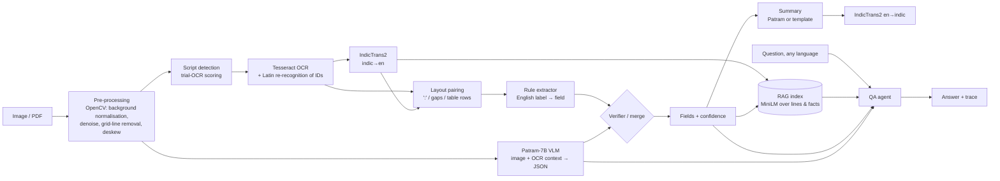
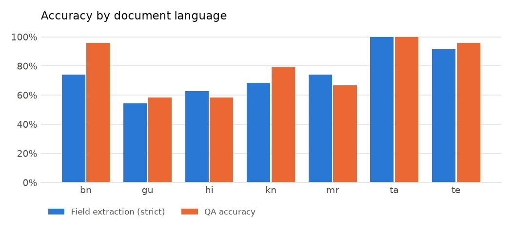
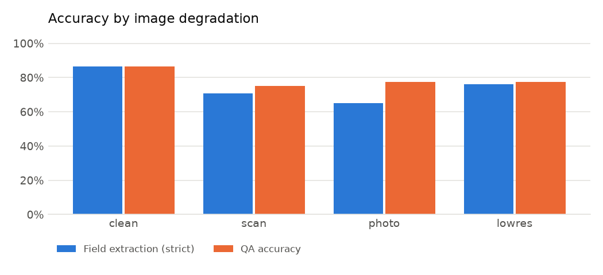

# Indian Document Understanding Tool

Upload an Indian-language **notice, form, certificate or bill** (image or PDF). The tool:

1. **extracts the key fields** (names, dates, reference numbers, amounts, district, PIN code, and so on) as a table and as JSON,
2. **summarises** the document in English *and* in the document's own language, and
3. **answers questions** about it, asked in English or in the document's language.

It handles Hindi, Marathi, Bengali, Tamil, Telugu, Kannada and Gujarati, which are all evaluated. Punjabi, Odia and Malayalam are wired in through Tesseract and IndicTrans2 but not evaluated.

> CIE-3 Lab · Project 3: *Indian Document Understanding Tool*. Models: **BharatGen Patram-7B-Instruct** and **AI4Bharat IndicTrans2**.

---

## 1. Problem and relevance

Citizens deal with government paperwork every day: scholarship notices, application forms, income certificates, electricity bills. It is written in the state's language and is often available only as a photo or scan. Three things make it hard:

- the text is in an Indic script, sometimes with **native digits** (२०२५, ২০২৫, ૨૦૨૫) and **Latin reference numbers** (`EDU/396/2025`) on the same line;
- the input is noisy: phone photos, skew, shadows, low resolution, ruled tables;
- the reader may not know the language. A migrant worker in Bengaluru, for example, may receive a Kannada notice.

Success means getting the *fields that matter* right (deadline, amount, reference number), so the tool is evaluated on **field-level accuracy** and **QA accuracy**, not on generic OCR scores alone.

## 2. Architecture



**Why this design.** Patram is the right model for *layout-aware* document VQA, but two facts about it shaped the pipeline:

- Its model card lists only English as a language.
- It needs a GPU: 7.67 B parameters, about 15 GB in BF16.

So the pipeline is **hybrid**:

- **OCR + IndicTrans2 rule extractor** (runs on a laptop CPU). OCR reads the native script. IndicTrans2 translates *only the labels* to English, so a single set of English keyword rules covers every Indian language. Values are kept exactly as printed.
- **Patram VLM** (GPU, optional). It sees the page image *plus* the OCR text translated into English, and returns JSON.
- **Verifier.** When the two extractors agree, the field gets 0.95 confidence. On conflict, it prefers the value that literally appears in the OCR text.

### GenAI / RAG / agentic integration

| Component | What it does |
|---|---|
| **Multimodal LLM** | Patram-7B answers extraction, summary and VQA prompts from the page image. The prompts are grounded with the OCR text translated into English. |
| **RAG** | Every OCR line (native + English) and every extracted fact is embedded with MiniLM. Questions retrieve the top-k chunks, which are passed to Patram or to an extractive reader (`deepset/tinyroberta-squad2`). |
| **Agent** (`docu/qa.py`) | It uses its tools in this order: `field_lookup` → `patram_vqa` → `rag_extractive`. Answers are checked against the OCR text, translated back into the question's language with IndicTrans2, and every step is shown in the UI ("Agent trace"). |
| **Cross-lingual** | A question in Tamil about a Tamil bill is translated to English, routed, answered, and the answer is returned in Tamil. |

## 3. Model and dataset selection (verified on 5 Nov 2026)

| Model | Checkpoint | Licence | Access | Hardware | Role |
|---|---|---|---|---|---|
| BharatGen **Patram-7B-Instruct** | `bharatgenai/patram-7b-instruct` | Apache-2.0 | gated (accept terms) | 7.67 B params in BF16, about 15 GB, so a GPU is needed: Colab T4 in 4-bit, or L4/A100. The maintainers pin `transformers==4.50.3`. | VLM extraction / VQA / summary |
| AI4Bharat **IndicTrans2** distilled | `ai4bharat/indictrans2-indic-en-dist-200M`, `…-en-indic-dist-200M` | MIT | gated (accept terms) | 200 M params, runs on CPU | label/text translation, answer back-translation |
| Tesseract 5 + Indic traineddata | `hin mar ben tam tel kan guj mal pan ori` | Apache-2.0 | open | CPU | OCR |
| all-MiniLM-L6-v2 | `sentence-transformers/all-MiniLM-L6-v2` | Apache-2.0 | open | CPU | retrieval |
| tinyroberta-squad2 | `deepset/tinyroberta-squad2` | CC-BY-4.0 | open | CPU | extractive reader |

**Considered and rejected:**
- **Param-1-2.9B** for generation. It needs about 6 GB in BF16, which doesn't fit beside the other models on an 8 GB laptop, and Patram already covers generation on the GPU path.
- **IndicTrans2 1B.** About 5× slower on CPU, for a task (short labels) where the 200M distilled model is enough.

**Dataset.** No public benchmark has Indian-language government documents with field-level labels, and real documents contain personal data. So `eval/generate_testset.py` builds a **task-specific synthetic test set** (see §5). The harness reads any folder that has the same `manifest.json` format, so real scanned documents can be added and scored in exactly the same way.

## 4. Setup

```bash
# system OCR
brew install tesseract tesseract-lang          # Ubuntu: apt install tesseract-ocr tesseract-ocr-{hin,mar,ben,tam,tel,kan,guj}
python3.11 -m venv .venv && source .venv/bin/activate
pip install -r requirements.txt

# gated models: accept the terms on the HF pages of IndicTrans2 (both directions) and Patram, then
hf auth login
```

### Run the app

```bash
python app.py                     # http://127.0.0.1:7860  (CPU pipeline)
```

### Enable Patram (GPU)

Open `notebooks/patram_colab.ipynb` in Colab or Kaggle. It:
1. installs `requirements-gpu.txt`;
2. starts `patram_server.py`, an OpenAI-compatible `/v1/chat/completions` endpoint, in 4-bit on a T4;
3. prints a public `trycloudflare.com` URL.

Then, on your laptop:

```bash
PATRAM_API_BASE=https://<id>.trycloudflare.com/v1 python app.py
```

`vllm serve bharatgenai/patram-7b-instruct --trust-remote-code` or SGLang also work as drop-in backends: the client only speaks the OpenAI chat schema.

## 5. Evaluation

```bash
python -m eval.generate_testset          # 42 docs → eval/testset/
python -m eval.run_eval                  # CPU pipeline → eval/results/local/
python -m eval.generate_testset --seed 99 --out eval/testset_final
python -m eval.run_eval --testset eval/testset_final --run final
PATRAM_API_BASE=... python -m eval.run_eval --patram   # → eval/results/patram/
```

### Test set: 42 documents · 245 gold fields · 168 questions

| Axis | Values |
|---|---|
| Languages | hi, mr, bn, ta, te, kn, gu (6 docs each) |
| Document types | application form (7 fields), public notice (5), income certificate (6), electricity bill (5) |
| Layout | `colon` list ("label : value") / ruled `table` (no separators) |
| Digits | ASCII or native script (about 35% of hi/mr/bn/gu docs) |
| Degradation | `clean`, `scan` (noise, blur, ±1.5° skew), `photo` (±3.5° rotation, uneven lighting, dark border, blur), `lowres` (about 75 dpi) |
| Questions | 3 English paraphrased questions + 1 question in the document's language per doc |

### Metrics

- **Field accuracy (strict):** type-aware exact match. Dates are normalised to DD/MM/YYYY, amounts to digits, and IDs and phone numbers to alphanumerics. Text fields match if they equal either the native or the romanised gold value.
- **Field accuracy (lenient):** also counts text fields with a fuzzy ratio of 85 or more.
- **Character error rate (CER)** on text fields, **document-type accuracy**, **language-ID accuracy**, and the **share of documents with every field correct**.
- **QA accuracy:** the gold value is contained in the answer, compared in the field's canonical form. Also reported: **exact match** and **token F1**.
- **Ablation:** QA accuracy *without* the field router (pure RAG reader), which measures what the agent's tool routing adds.
- Breakdowns by language, degradation, layout, digit script, field, document type, question language, and the tool the agent used.

### Results

> `eval/results/<run>/report.md` holds the full tables, charts and error examples. They are also shown in the app's **Evaluation** tab.

CPU pipeline (Tesseract + IndicTrans2-200M + RAG) on an Apple M3 with 8 GB of RAM. Patram was not used in these runs (see §4 to add it).

**Protocol.** Development fixes were made while looking at errors on the `dev` set (seed 7) and then the `holdout` set (seed 2026). The **`final`** set (seed 99, `eval/testset_final`) was generated after the last code change and was never inspected while developing, so it is the number to quote.

| Run | Field acc. (strict) | Field acc. (lenient) | Docs 100 % correct | Text CER | QA acc. | QA EM | QA token F1 | QA w/o router |
|---|---|---|---|---|---|---|---|---|
| dev, v1 (first full run) | 73.5 % | 75.1 % | 31.0 % | 0.184 | 81.0 % | 78.6 % | 0.847 | 64.3 % |
| dev, v3 | 77.1 % | 78.8 % | 38.1 % | 0.149 | 83.3 % | 81.0 % | 0.869 | 66.7 % |
| holdout, v3 | 75.9 % | 77.1 % | 21.4 % | 0.172 | 76.2 % | 75.6 % | 0.832 | 56.5 % |
| **final, v3 (unseen)** | **75.1 %** | **76.3 %** | **38.1 %** | **0.186** | **79.2 %** | **77.4 %** | **0.835** | **54.8 %** |

On every set, **language ID is 100%** (42/42) and **document-type accuracy is 95.2%** (40/42). Runtime is about 13–17 s per document on CPU.

**The agent's field router adds about 24 points of QA accuracy** on the final set (79.2% vs 54.8% for the pure retrieve-and-read baseline). Questions asked in the document's own language score *higher* than English ones (85.7% vs 77.0%). They use fixed phrasing, which IndicTrans2 translates reliably.

**Final-set breakdown (field accuracy, strict):**

| Slice | Accuracy |
|---|---|
| Language | ta 100 % · te 91.4 % · bn 74.3 % · mr 74.3 % · kn 68.6 % · hi 62.9 % · gu 54.3 % |
| Degradation | clean 86.5 % · lowres 76.0 % · scan 70.9 % · photo 65.2 % |
| Layout | colon list 81.5 % · ruled table 61.0 % |
| Digits | ASCII 82.5 % · **native script 50.0 %** |
| Doc type | application form 87.8 % · bill 77.1 % · notice 71.4 % · income certificate 50.0 % |
| Weakest fields | certificate number 14.3 % · notice number 42.9 % · annual income / issue date 57.1 % |




Full tables and per-error examples: [`eval/results/final/report.md`](eval/results/final/report.md). Per-item CSVs: `fields.csv`, `qa.csv`.

### Failure analysis

Every wrong field or answer is put into a category automatically (`eval/run_eval.py`):

| Category | Meaning |
|---|---|
| `ocr_error` | the gold value never appears in the OCR text |
| `label_value_not_paired` | value was OCR'd but no label/value pair was formed |
| `label_translation_unmatched` | IndicTrans2's English label matched no field rule |
| `label_mapped_to_wrong_field` | the translated label matched the wrong field |
| `value_split_or_normalisation` | extracted, but extra or missing tokens |
| `routed_to_wrong_field` / `extracted_field_wrong` / `rag_reader_wrong` / `patram_wrong` | QA-side failures |

**Findings from development** (each one measured on the test set, then fixed or documented):

| # | Observation | Evidence | Action |
|---|---|---|---|
| 1 | Plain Tesseract (grayscale + autocontrast) failed on `photo` pages: dark border, lighting gradient. | 4 of 5 sampled photo pages returned no field lines | Background normalisation (morphological close + divide), NL-means denoising, Otsu, projection-profile deskew. Gold values found verbatim in the OCR text went to **167/245**. |
| 2 | Ruled tables made Tesseract drop whole rows. | rows missing in `table` docs | Morphological removal of horizontal and vertical lines before OCR. |
| 3 | Tesseract's OSD script detector chose Latin for some Marathi and Gujarati pages. | 3/42 wrong | Trial-OCR scoring (confidence × share of characters in the expected script): **42/42**. |
| 4 | The Kannada model often drops the ":" separator, and table rows come out as two lines. | 0 pairs on 2 Kannada docs | Translate word prefixes with IndicTrans2 and keep the longest one that reads as a label; pair label-only lines with the next line. |
| 5 | Indic OCR models misread Latin in IDs (`EDU/…` → `600/…`, `IC` → `1C`). | most common `ocr_error` | Re-read ID-like tokens with the English model when it is more confident. Partly fixed; the remaining cases are the clearest argument for Patram. |
| 6 | Gujarati digit ૨ and letter ર look the same. | `₹ ર,497` | Look-alike digit mapping, applied only to numeric fields. |
| 7 | Notices name the issuing department only in the letterhead. | `department` missed on all notices | Letterhead heuristic. |
| 8 | Question routing: "Whose income certificate…" went to the income field, and "…published?" went to the department field. | QA errors | Rule order fixed. The ablation shows the router's net value. |
| 9 | **Word-sense error in translation:** the single Marathi label "नाव" (= *name*, but also *boat*) is translated as "the boat". In context, "नाव : सचिन पाटील", it becomes "Full name: Sachin Patil". | `name` missed on 3/6 Marathi docs | If a label matches no rule, translate the whole "label : value" text and read the label part. |
| 10 | IndicTrans2 gives valid synonyms the rules lacked: "Advertisement No" and "Publication No." for *notice number*, "The number of users" for *consumer number*. | `label_translation_unmatched` 10 → 2 | Synonyms added to the English rules. |
| 11 | Tesseract outputs the ":" separator as the script's **visarga** (ः ঃ ઃ ః ಃ), e.g. `તારીખઃ13/02/2025`, and notice lines put two pairs in one cell. | dates on notices mapped to the wrong field | Visarga is treated as a separator before a space or digit; multi-pair cells are split. |

**Where the remaining errors are (final set, 61 field errors):**
- **75% are `ocr_error`** (46 of 61): the value never reaches the text.
  - Most come from **native-script digits** (50% accuracy vs 82.5% for ASCII). Tesseract reads Gujarati ૨/ર, Devanagari ०/o and similar pairs as letters, or reads `₹ १००` as `₹ Roo`.
  - Next come **Latin prefixes inside Indic lines** (`IC/…` → `1C/…`, `SW/…` → `9///…`). That is why certificate and notice numbers are the weakest fields.
- **Ruled tables** (61% vs 81.5% for colon lists): table rows are split into separate label and value lines, or merged with the next row.
- **On the QA side, 25 of 35 errors are `extracted_field_wrong`**: the router chose the right field, but the extracted value was wrong. QA errors therefore follow field errors, so better OCR helps both.
- **What would fix most of this:** Patram reads the page image directly instead of Tesseract's characters. That makes it the natural fix for digit and Latin-prefix confusions; the verifier in `extract.py` already merges its output. Measuring that needs a GPU run (`run_eval --patram`).

**Known limitations.**
- The test set is synthetic: clean fonts, fixed templates, no handwriting, stamps or multi-column layouts. Its numbers are an upper bound for printed forms.
- The keyword rules cover 4 document types. Other types still get OCR, translation, RAG-based QA and Patram output, but no structured fields.
- Low-resolution scans (about 75 dpi) are the main source of digit errors. No post-OCR language model corrects them.
- **Names are *translated*, not transliterated**, in the English column: Tamil "முருகன் செல்வம்" becomes "Murugan **Wealth**", because செல்வம் also means *wealth*. The native-script value, which is what's scored and shown first, is unaffected. AI4Bharat IndicXlit, which transliterates names instead of translating them, would be the right tool for name fields.
- The back-translated summary inherits word-sense slips. For example, "electricity bill" became மின்சார **மசோதா**, a legislative bill. The English summary and the extracted fields are the reliable outputs.

## 6. Repository layout

```
app.py                    Gradio frontend
patram_server.py          OpenAI-compatible Patram server (GPU)
docu/
  ingest.py               PDF/image loading + OpenCV pre-processing
  ocr.py                  script detection, Tesseract, layout cells, Latin re-recognition
  langid.py               Unicode-script language ID (+ Hindi/Marathi split)
  translate.py            IndicTrans2 wrapper (batched, cached)
  schema.py               document types, fields, English routing rules
  extract.py              rule extractor, Patram extractor, verifier/merge
  rag.py                  MiniLM index + extractive reader
  qa.py                   QA agent with tool trace
  summarize.py            Patram / template summary + back-translation
  pipeline.py             orchestration
eval/
  lexicon.py              multilingual labels, names, places, questions
  generate_testset.py     synthetic document renderer (Pillow + HarfBuzz/raqm)
  run_eval.py             metrics, ablation, failure taxonomy, report + charts
  testset/                dev set: 42 PNGs + manifest.json (seed 7)
  testset_holdout/        held-out set (seed 2026)
  testset_final/          final unseen test set (seed 99)
  results/<run>/          fields.csv, qa.csv, metrics.json, report.md, *.png
notebooks/patram_colab.ipynb
samples/                  one sample document per language
```

## 7. Ethics and data

- All test documents are synthetic: the names are common names and the numbers are random, so no real person's data is included.
- Uploaded documents are processed locally. With Patram enabled, the page image is sent to **your own** GPU endpoint.
- Extracted values carry a confidence score and a source. Low-confidence fields should be checked by a person before anyone acts on them.
