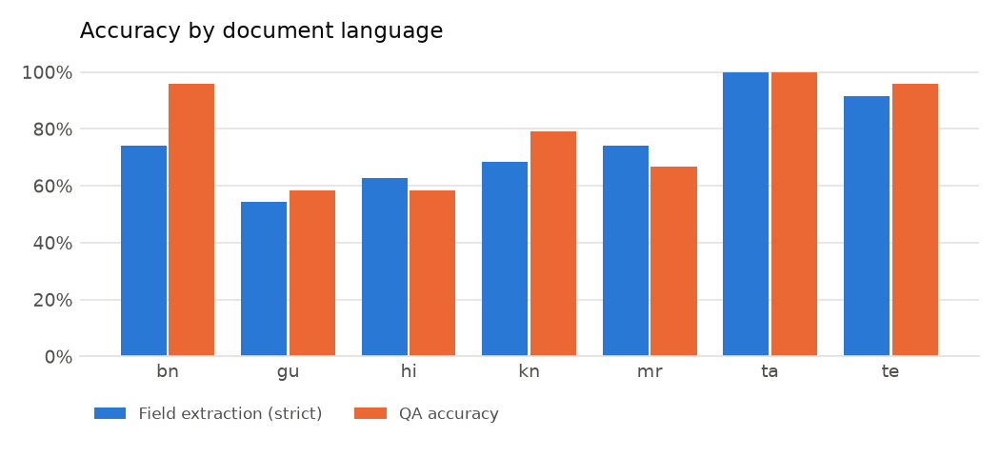
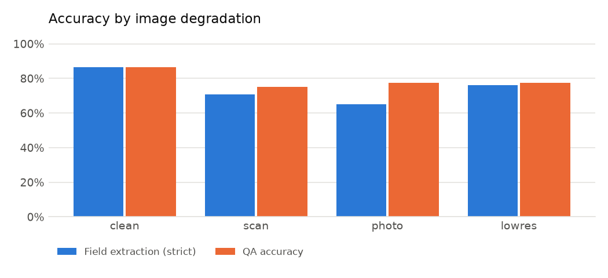
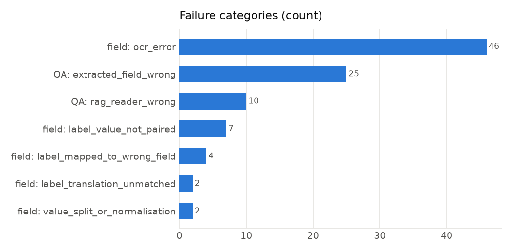

# Evaluation report

- Documents: **42**, gold fields: **245**, questions: **168**
- Patram VLM enabled: **False**; runtime 14.0 s/doc

## Headline metrics

| Metric | Value |
|---|---|
| field_accuracy_strict | 75.1% |
| field_accuracy_lenient | 76.3% |
| documents_fully_correct | 38.1% |
| doc_type_accuracy | 95.2% |
| language_id_accuracy | 100.0% |
| text_field_mean_cer | 0.186 |
| qa_accuracy | 79.2% |
| qa_exact_match | 77.4% |
| qa_token_f1 | 83.5% |
| seconds_total | 587.9 |
| seconds_per_doc | 14.0 |
| qa_accuracy_without_router | 54.8% |

### field by language

| key | accuracy |
|---|---|
| bn | 74.3% |
| gu | 54.3% |
| hi | 62.9% |
| kn | 68.6% |
| mr | 74.3% |
| ta | 100.0% |
| te | 91.4% |

### field by degradation

| key | accuracy |
|---|---|
| clean | 86.5% |
| lowres | 76.0% |
| photo | 65.2% |
| scan | 70.9% |

### field by layout

| key | accuracy |
|---|---|
| colon | 81.5% |
| table | 61.0% |

### field by native digits

| key | accuracy |
|---|---|
| False | 82.5% |
| True | 50.0% |

### field by field

| key | accuracy |
|---|---|
| annual_income | 57.1% |
| application_number | 71.4% |
| bill_amount | 85.7% |
| certificate_number | 14.3% |
| consumer_number | 57.1% |
| date | 71.4% |
| date_of_birth | 100.0% |
| department | 78.6% |
| district | 71.4% |
| due_date | 71.4% |
| father_name | 71.4% |
| fee | 85.7% |
| issue_date | 57.1% |
| last_date | 78.6% |
| mobile | 92.9% |
| name | 82.1% |
| notice_number | 42.9% |
| pin_code | 92.9% |
| units_consumed | 100.0% |

### qa by language

| key | accuracy |
|---|---|
| bn | 95.8% |
| gu | 58.3% |
| hi | 58.3% |
| kn | 79.2% |
| mr | 66.7% |
| ta | 100.0% |
| te | 95.8% |

### qa by question language

| key | accuracy |
|---|---|
| en | 77.0% |
| native | 85.7% |

### qa by tool

| key | accuracy |
|---|---|
| field_lookup | 84.0% |
| rag_extractive | 16.7% |

## Failure analysis

| Category | Count | Meaning |
|---|---|---|
| field: ocr_error | 46 | the gold value never appears in the OCR text (misread characters, lost rows, digit/letter confusion) |
| field: label_value_not_paired | 7 | value is in the OCR text but no label/value pair was formed (missing ':' or table row split oddly) |
| field: label_mapped_to_wrong_field | 4 | the translated label matched a different field's rule |
| field: label_translation_unmatched | 2 | a pair was formed but IndicTrans2's English label matched no field rule |
| field: value_split_or_normalisation | 2 | a value was extracted but differs from gold (extra/missing tokens, normalisation) |
| QA: extracted_field_wrong | 25 | router chose the right field but the extracted value itself was wrong |
| QA: rag_reader_wrong | 10 | no field matched; retrieval + extractive reader picked the wrong span |

### Example field errors (up to 25)

| doc | field | gold | predicted | category |
|---|---|---|---|---|
| 00_hi_application_form | mobile | 7146881973 | 774688973 | ocr_error |
| 00_hi_application_form | pin_code | 552121 | 552727 | ocr_error |
| 01_hi_public_notice | notice_number | RD/793/2025 | — | label_translation_unmatched |
| 01_hi_public_notice | department | ग्रामीण विकास विभाग | — | label_value_not_paired |
| 01_hi_public_notice | last_date | 29/10/2025 | 29/॥0/2025 | ocr_error |
| 02_hi_income_certificate | certificate_number | IC/2024/235412 | — | ocr_error |
| 02_hi_income_certificate | annual_income | 158000 | 58000 | ocr_error |
| 02_hi_income_certificate | district | भोपाल | भोपाल क | value_split_or_normalisation |
| 02_hi_income_certificate | issue_date | 13/06/2024 | jroo a | ocr_error |
| 03_hi_electricity_bill | consumer_number | 124906528630 | 24906528630 | ocr_error |
| 03_hi_electricity_bill | bill_amount | 1675 | 7675 | ocr_error |
| 05_hi_public_notice | notice_number | SW/524/2025 | — | ocr_error |
| 05_hi_public_notice | department | समाज कल्याण विभाग | — | label_value_not_paired |
| 06_mr_application_form | father_name | रामदास जाधव | — | label_mapped_to_wrong_field |
| 06_mr_application_form | application_number | REG/2025/52021 | 260/2025/52021 | ocr_error |
| 07_mr_public_notice | notice_number | EDU/783/2025 | 600/783/2025 | ocr_error |
| 08_mr_income_certificate | certificate_number | IC/2023/626024 | — | ocr_error |
| 08_mr_income_certificate | father_name | रामदास जाधव | — | label_mapped_to_wrong_field |
| 09_mr_electricity_bill | consumer_number | 899430141900 | 8994304900 | ocr_error |
| 09_mr_electricity_bill | due_date | 13/10/2025 | 03/10/2025 | ocr_error |
| 10_mr_application_form | application_number | APP/2025/72806 | 1॥0?/2025/72806 | ocr_error |
| 11_mr_public_notice | notice_number | RD/851/2025 | 20/851/2025 | ocr_error |
| 12_bn_application_form | father_name | অশোক দাস | — | ocr_error |
| 12_bn_application_form | district | নদিয়া | — | ocr_error |
| 14_bn_income_certificate | certificate_number | IC/2025/646561 | — | ocr_error |

### Example QA errors (up to 20)

| doc | question | gold | answer | tool | category |
|---|---|---|---|---|---|
| 00_hi_application_form | What is the PIN code? | 552121 | 552727 | field_lookup | extracted_field_wrong |
| 01_hi_public_notice | Which department issued this notice? | ग्रामीण विकास विभाग | Department of Rural Development | rag_extractive | rag_reader_wrong |
| 01_hi_public_notice | What is the notice number? | RD/793/2025 | 250 | rag_extractive | rag_reader_wrong |
| 01_hi_public_notice | आवेदन की अंतिम तिथि क्या है? | 29/10/2025 | 29/॥0/2025 | field_lookup | extracted_field_wrong |
| 02_hi_income_certificate | What is the certificate number? | IC/2024/235412 | 1C / 2024/235412 | rag_extractive | rag_reader_wrong |
| 02_hi_income_certificate | What is the annual income stated? | 158000 | 58000 | field_lookup | extracted_field_wrong |
| 02_hi_income_certificate | वार्षिक आय कितनी है? | 158000 | 58000 | field_lookup | extracted_field_wrong |
| 03_hi_electricity_bill | What is the total bill amount? | 1675 | 7675 | field_lookup | extracted_field_wrong |
| 03_hi_electricity_bill | What is the consumer number? | 124906528630 | 24906528630 | field_lookup | extracted_field_wrong |
| 03_hi_electricity_bill | बिल की राशि कितनी है? | 1675 | 7675 | field_lookup | extracted_field_wrong |
| 06_mr_application_form | What is the application number? | REG/2025/52021 | 260/2025/52021 | field_lookup | extracted_field_wrong |
| 07_mr_public_notice | What is the notice number? | EDU/783/2025 | 600/783/2025 | field_lookup | extracted_field_wrong |
| 08_mr_income_certificate | What is the father's name on the certificate? | रामदास जाधव | Ganesh Jadhav | rag_extractive | rag_reader_wrong |
| 08_mr_income_certificate | What is the certificate number? | IC/2023/626024 | 0/2023/626024 | rag_extractive | rag_reader_wrong |
| 09_mr_electricity_bill | By when should the bill be paid? | 13/10/2025 | 03/10/2025 | field_lookup | extracted_field_wrong |
| 09_mr_electricity_bill | What is the consumer number? | 899430141900 | 8994304900 | field_lookup | extracted_field_wrong |
| 10_mr_application_form | What is the application number? | APP/2025/72806 | 1॥0?/2025/72806 | field_lookup | extracted_field_wrong |
| 11_mr_public_notice | What is the notice number? | RD/851/2025 | 20/851/2025 | field_lookup | extracted_field_wrong |
| 14_bn_income_certificate | What is the certificate number? | IC/2025/646561 | 422000
13/01/2024 | rag_extractive | rag_reader_wrong |
| 26_te_income_certificate | Which district is mentioned on the certificate? | గుంటూరు | the District | rag_extractive | rag_reader_wrong |
