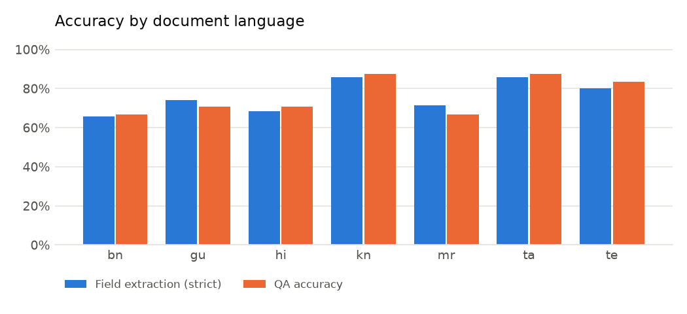
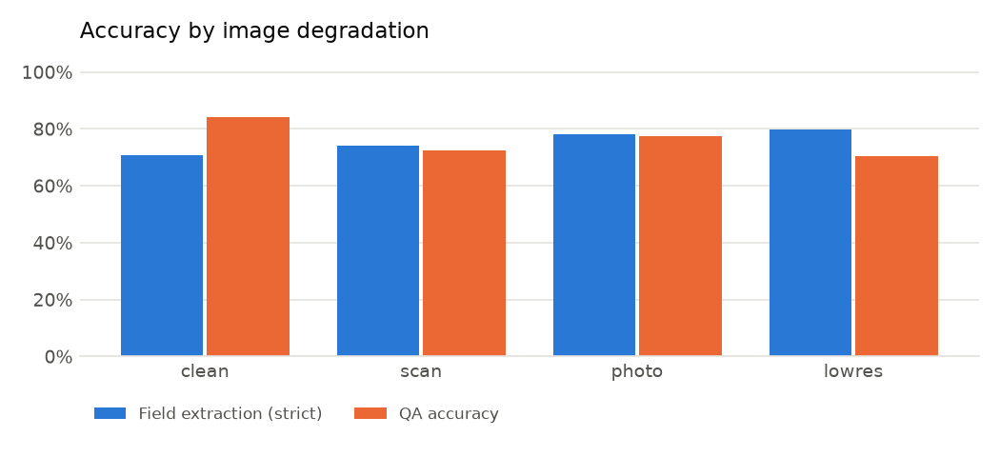
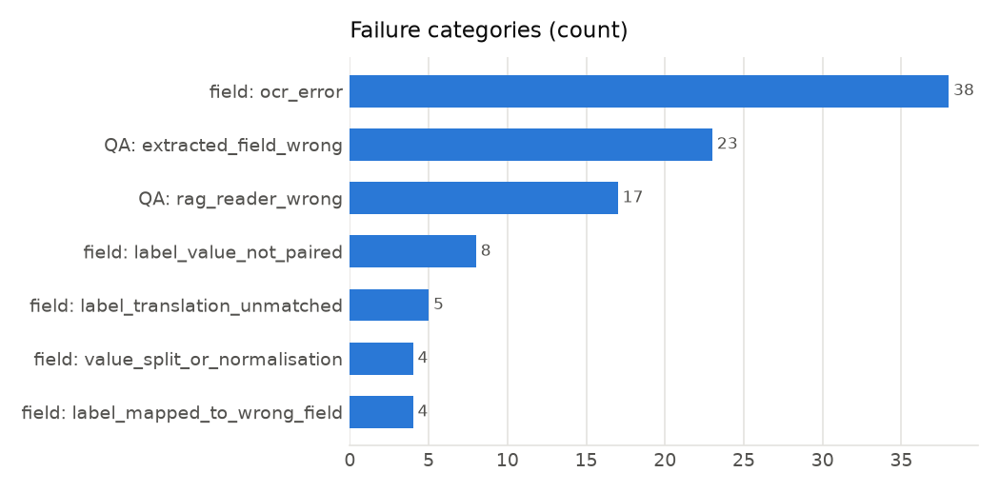

# Evaluation report

- Documents: **42**, gold fields: **245**, questions: **168**
- Patram VLM enabled: **False**; runtime 12.0 s/doc

## Headline metrics

| Metric | Value |
|---|---|
| field_accuracy_strict | 75.9% |
| field_accuracy_lenient | 77.1% |
| documents_fully_correct | 21.4% |
| doc_type_accuracy | 95.2% |
| language_id_accuracy | 100.0% |
| text_field_mean_cer | 0.172 |
| qa_accuracy | 76.2% |
| qa_exact_match | 75.6% |
| qa_token_f1 | 83.2% |
| seconds_total | 502.4 |
| seconds_per_doc | 12.0 |
| qa_accuracy_without_router | 56.5% |

### field by language

| key | accuracy |
|---|---|
| bn | 65.7% |
| gu | 74.3% |
| hi | 68.6% |
| kn | 85.7% |
| mr | 71.4% |
| ta | 85.7% |
| te | 80.0% |

### field by degradation

| key | accuracy |
|---|---|
| clean | 70.9% |
| lowres | 79.7% |
| photo | 78.0% |
| scan | 74.2% |

### field by layout

| key | accuracy |
|---|---|
| colon | 77.0% |
| table | 73.8% |

### field by native digits

| key | accuracy |
|---|---|
| False | 76.1% |
| True | 75.0% |

### field by field

| key | accuracy |
|---|---|
| annual_income | 85.7% |
| application_number | 50.0% |
| bill_amount | 71.4% |
| certificate_number | 0.0% |
| consumer_number | 85.7% |
| date | 71.4% |
| date_of_birth | 92.9% |
| department | 57.1% |
| district | 76.2% |
| due_date | 85.7% |
| father_name | 81.0% |
| fee | 78.6% |
| issue_date | 85.7% |
| last_date | 92.9% |
| mobile | 100.0% |
| name | 78.6% |
| notice_number | 42.9% |
| pin_code | 100.0% |
| units_consumed | 85.7% |

### qa by language

| key | accuracy |
|---|---|
| bn | 66.7% |
| gu | 70.8% |
| hi | 70.8% |
| kn | 87.5% |
| mr | 66.7% |
| ta | 87.5% |
| te | 83.3% |

### qa by question language

| key | accuracy |
|---|---|
| en | 74.6% |
| native | 81.0% |

### qa by tool

| key | accuracy |
|---|---|
| field_lookup | 84.7% |
| rag_extractive | 5.6% |

## Failure analysis

| Category | Count | Meaning |
|---|---|---|
| field: ocr_error | 38 | the gold value never appears in the OCR text (misread characters, lost rows, digit/letter confusion) |
| field: label_value_not_paired | 8 | value is in the OCR text but no label/value pair was formed (missing ':' or table row split oddly) |
| field: label_translation_unmatched | 5 | a pair was formed but IndicTrans2's English label matched no field rule |
| field: value_split_or_normalisation | 4 | a value was extracted but differs from gold (extra/missing tokens, normalisation) |
| field: label_mapped_to_wrong_field | 4 | the translated label matched a different field's rule |
| QA: extracted_field_wrong | 23 | router chose the right field but the extracted value itself was wrong |
| QA: rag_reader_wrong | 17 | no field matched; retrieval + extractive reader picked the wrong span |

### Example field errors (up to 25)

| doc | field | gold | predicted | category |
|---|---|---|---|---|
| 00_hi_application_form | application_number | SCH/2025/22851 | 50/2025/22851 | ocr_error |
| 01_hi_public_notice | notice_number | SW/191/2025 | — | ocr_error |
| 01_hi_public_notice | department | ग्रामीण विकास विभाग | — | label_value_not_paired |
| 02_hi_income_certificate | certificate_number | IC/2025/622668 | ।|8/2025/622668 | ocr_error |
| 02_hi_income_certificate | annual_income | 107000 | 07000 | ocr_error |
| 03_hi_electricity_bill | consumer_number | 819672731778 | 87967273778 | ocr_error |
| 03_hi_electricity_bill | bill_amount | 2183 | 2 | ocr_error |
| 04_hi_application_form | application_number | SCH/2025/69985 | 59-/2025/69985 | ocr_error |
| 05_hi_public_notice | notice_number | EDU/865/2025 | — | label_translation_unmatched |
| 05_hi_public_notice | date | 16/04/2025 | 06/04/2025 | ocr_error |
| 05_hi_public_notice | department | शिक्षा विभाग | — | label_value_not_paired |
| 06_mr_application_form | application_number | REG/2025/27198 | 1605/2025/27198 | ocr_error |
| 07_mr_public_notice | fee | 100 | 00 | ocr_error |
| 08_mr_income_certificate | certificate_number | IC/2025/748655 | — | ocr_error |
| 09_mr_electricity_bill | units_consumed | 181 | 84 | ocr_error |
| 09_mr_electricity_bill | bill_amount | 1115 | 745 | ocr_error |
| 10_mr_application_form | name | स्नेहा देशमुख | — | label_value_not_paired |
| 10_mr_application_form | father_name | अनिल देशमुख | 27/04/1997 | value_split_or_normalisation |
| 10_mr_application_form | date_of_birth | 27/04/1997 | — | label_mapped_to_wrong_field |
| 10_mr_application_form | application_number | SCH/2025/22394 | — | ocr_error |
| 11_mr_public_notice | fee | 1000 | 000 | ocr_error |
| 12_bn_application_form | name | রিয়া সেন | — | ocr_error |
| 12_bn_application_form | father_name | তপন সেন | — | ocr_error |
| 12_bn_application_form | district | কলকাতা | লকা3। | ocr_error |
| 12_bn_application_form | application_number | SCH/2025/43570 | — | label_translation_unmatched |

### Example QA errors (up to 20)

| doc | question | gold | answer | tool | category |
|---|---|---|---|---|---|
| 00_hi_application_form | What is the application number? | SCH/2025/22851 | 50/2025/22851 | field_lookup | extracted_field_wrong |
| 02_hi_income_certificate | What is the annual income stated? | 107000 | 07000 | field_lookup | extracted_field_wrong |
| 02_hi_income_certificate | वार्षिक आय कितनी है? | 107000 | 07000 | field_lookup | extracted_field_wrong |
| 03_hi_electricity_bill | What is the total bill amount? | 2183 | 2 | field_lookup | extracted_field_wrong |
| 03_hi_electricity_bill | बिल की राशि कितनी है? | 2183 | 2 | field_lookup | extracted_field_wrong |
| 05_hi_public_notice | Which department issued this notice? | शिक्षा विभाग | Department of Education | rag_extractive | rag_reader_wrong |
| 05_hi_public_notice | What is the notice number? | EDU/865/2025 | 500 | rag_extractive | rag_reader_wrong |
| 06_mr_application_form | What is the application number? | REG/2025/27198 | 1605/2025/27198 | field_lookup | extracted_field_wrong |
| 07_mr_public_notice | How much is the application fee? | 100 | 00 | field_lookup | extracted_field_wrong |
| 08_mr_income_certificate | What is the certificate number? | IC/2025/748655 | 2025/748655 | rag_extractive | rag_reader_wrong |
| 09_mr_electricity_bill | What is the total bill amount? | 1115 | 745 | field_lookup | extracted_field_wrong |
| 09_mr_electricity_bill | बिलाची रक्कम किती आहे? | 1115 | 745 | field_lookup | extracted_field_wrong |
| 10_mr_application_form | What is the name of the applicant's father? | अनिल देशमुख | 27/04/1997 | field_lookup | extracted_field_wrong |
| 10_mr_application_form | अर्जदाराचे नाव काय आहे? | स्नेहा देशमुख | अर्ज क्रमांक. अर्जावर स्वाक्षरी करणारा/अधिकारी | rag_extractive | rag_reader_wrong |
| 11_mr_public_notice | How much is the application fee? | 1000 | 000 | field_lookup | extracted_field_wrong |
| 12_bn_application_form | What is the name of the applicant's father? | তপন সেন | M.B. S. No: 8218549145 | rag_extractive | rag_reader_wrong |
| 12_bn_application_form | Which district is the applicant from? | কলকাতা | লকা3। | field_lookup | extracted_field_wrong |
| 12_bn_application_form | What is the application number? | SCH/2025/43570 | 8218549145 | rag_extractive | rag_reader_wrong |
| 12_bn_application_form | আবেদনকারীর নাম কী? | রিয়া সেন | উন্নয়ন বিভাগ | rag_extractive | rag_reader_wrong |
| 13_bn_public_notice | Which department issued this notice? | সমাজকল্যাণ বিভাগ | সমাঞ্0)।ণ বিভাগ | field_lookup | extracted_field_wrong |
