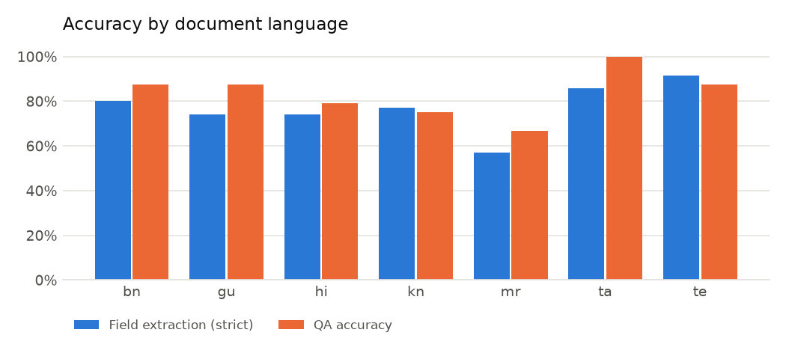
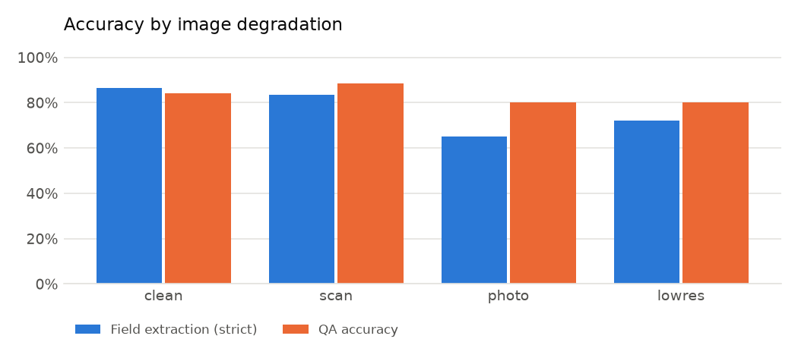
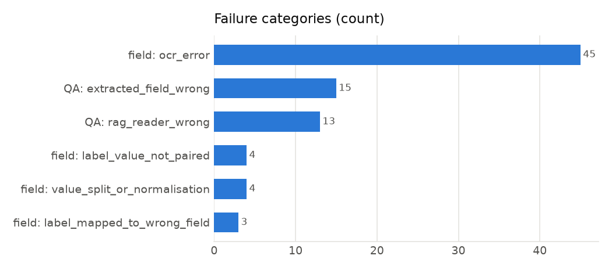

# Evaluation report

- Documents: **42**, gold fields: **245**, questions: **168**
- Patram VLM enabled: **False**; runtime 13.4 s/doc

## Headline metrics

| Metric | Value |
|---|---|
| field_accuracy_strict | 77.1% |
| field_accuracy_lenient | 78.8% |
| documents_fully_correct | 38.1% |
| doc_type_accuracy | 95.2% |
| language_id_accuracy | 100.0% |
| text_field_mean_cer | 0.149 |
| qa_accuracy | 83.3% |
| qa_exact_match | 81.0% |
| qa_token_f1 | 86.9% |
| seconds_total | 563.6 |
| seconds_per_doc | 13.4 |
| qa_accuracy_without_router | 66.7% |

### field by language

| key | accuracy |
|---|---|
| bn | 80.0% |
| gu | 74.3% |
| hi | 74.3% |
| kn | 77.1% |
| mr | 57.1% |
| ta | 85.7% |
| te | 91.4% |

### field by degradation

| key | accuracy |
|---|---|
| clean | 86.5% |
| lowres | 72.0% |
| photo | 65.2% |
| scan | 83.6% |

### field by layout

| key | accuracy |
|---|---|
| colon | 80.1% |
| table | 71.4% |

### field by native digits

| key | accuracy |
|---|---|
| False | 79.8% |
| True | 67.3% |

### field by field

| key | accuracy |
|---|---|
| annual_income | 85.7% |
| application_number | 50.0% |
| bill_amount | 85.7% |
| certificate_number | 14.3% |
| consumer_number | 71.4% |
| date | 85.7% |
| date_of_birth | 92.9% |
| department | 71.4% |
| district | 90.5% |
| due_date | 85.7% |
| father_name | 76.2% |
| fee | 85.7% |
| issue_date | 71.4% |
| last_date | 92.9% |
| mobile | 78.6% |
| name | 75.0% |
| notice_number | 50.0% |
| pin_code | 92.9% |
| units_consumed | 85.7% |

### qa by language

| key | accuracy |
|---|---|
| bn | 87.5% |
| gu | 87.5% |
| hi | 79.2% |
| kn | 75.0% |
| mr | 66.7% |
| ta | 100.0% |
| te | 87.5% |

### qa by question language

| key | accuracy |
|---|---|
| en | 81.7% |
| native | 88.1% |

### qa by tool

| key | accuracy |
|---|---|
| field_lookup | 90.3% |
| rag_extractive | 7.1% |

## Failure analysis

| Category | Count | Meaning |
|---|---|---|
| field: ocr_error | 45 | the gold value never appears in the OCR text (misread characters, lost rows, digit/letter confusion) |
| field: label_value_not_paired | 4 | value is in the OCR text but no label/value pair was formed (missing ':' or table row split oddly) |
| field: value_split_or_normalisation | 4 | a value was extracted but differs from gold (extra/missing tokens, normalisation) |
| field: label_mapped_to_wrong_field | 3 | the translated label matched a different field's rule |
| QA: extracted_field_wrong | 15 | router chose the right field but the extracted value itself was wrong |
| QA: rag_reader_wrong | 13 | no field matched; retrieval + extractive reader picked the wrong span |

### Example field errors (up to 25)

| doc | field | gold | predicted | category |
|---|---|---|---|---|
| 00_hi_application_form | application_number | SCH/2025/19156 | SCH/2024/2824§ | ocr_error |
| 01_hi_public_notice | notice_number | EDU/396/2025 | — | ocr_error |
| 01_hi_public_notice | department | ग्रामीण विकास विभाग | — | label_value_not_paired |
| 02_hi_income_certificate | certificate_number | IC/2025/657549 | 1C/2025/657549 | ocr_error |
| 03_hi_electricity_bill | consumer_number | 911862527601 | 9486252760 | ocr_error |
| 03_hi_electricity_bill | units_consumed | 611 | 6 | ocr_error |
| 03_hi_electricity_bill | bill_amount | 4413 | 4473 | ocr_error |
| 05_hi_public_notice | notice_number | SW/240/2025 | — | ocr_error |
| 05_hi_public_notice | department | ग्रामीण विकास विभाग | — | label_value_not_paired |
| 06_mr_application_form | application_number | APP/2025/77566 | ॥0?/2025/77566 | ocr_error |
| 07_mr_public_notice | notice_number | EDU/313/2025 | 600/313/2025 | ocr_error |
| 07_mr_public_notice | fee | 100 | ₹ Roo | ocr_error |
| 08_mr_income_certificate | certificate_number | IC/2024/255766 | — | ocr_error |
| 08_mr_income_certificate | issue_date | 15/09/2024 | 05/09/2024 | ocr_error |
| 09_mr_electricity_bill | consumer_number | 154728038528 | 54728038528 | ocr_error |
| 10_mr_application_form | name | स्नेहा देशमुख | — | ocr_error |
| 10_mr_application_form | father_name | अनिल देशमुख | — | ocr_error |
| 10_mr_application_form | date_of_birth | 03/03/1985 | — | ocr_error |
| 10_mr_application_form | mobile | 7875004743 | — | ocr_error |
| 10_mr_application_form | district | नाशिक | — | ocr_error |
| 10_mr_application_form | pin_code | 744535 | — | ocr_error |
| 10_mr_application_form | application_number | SCH/2025/68619 | — | ocr_error |
| 11_mr_public_notice | notice_number | RD/452/2025 | 20/452/2025 | ocr_error |
| 11_mr_public_notice | fee | 100 | ₹ Roo | ocr_error |
| 12_bn_application_form | name | পূজা মন্ডল | — | ocr_error |

### Example QA errors (up to 20)

| doc | question | gold | answer | tool | category |
|---|---|---|---|---|---|
| 00_hi_application_form | What is the application number? | SCH/2025/19156 | SCH/2024/2824§ | field_lookup | extracted_field_wrong |
| 01_hi_public_notice | What is the notice number? | EDU/396/2025 | 1000 | rag_extractive | rag_reader_wrong |
| 01_hi_public_notice | Which department issued this notice? | ग्रामीण विकास विभाग | Department of Rural Development | rag_extractive | rag_reader_wrong |
| 03_hi_electricity_bill | What is the total bill amount? | 4413 | 4473 | field_lookup | extracted_field_wrong |
| 03_hi_electricity_bill | बिल की राशि कितनी है? | 4413 | 4473 | field_lookup | extracted_field_wrong |
| 07_mr_public_notice | How much is the application fee? | 100 | ₹ Roo | field_lookup | extracted_field_wrong |
| 07_mr_public_notice | What is the notice number? | EDU/313/2025 | 600/313/2025 | field_lookup | extracted_field_wrong |
| 08_mr_income_certificate | What is the certificate number? | IC/2024/255766 | €/ 2024/255766 | rag_extractive | rag_reader_wrong |
| 09_mr_electricity_bill | What is the consumer number? | 154728038528 | 54728038528 | field_lookup | extracted_field_wrong |
| 10_mr_application_form | What phone number can the applicant be reached on? | 7875004743 | No | rag_extractive | rag_reader_wrong |
| 10_mr_application_form | What is the PIN code? | 744535 | No | rag_extractive | rag_reader_wrong |
| 10_mr_application_form | Which district is the applicant from? | नाशिक | Department of Social Welfare
the Signatory / Officer
No | rag_extractive | rag_reader_wrong |
| 10_mr_application_form | अर्जदाराचे नाव काय आहे? | स्नेहा देशमुख | स्वाक्षरीकर्ता/अधिकारी | rag_extractive | rag_reader_wrong |
| 12_bn_application_form | Who submitted this application? | পূজা মন্ডল | Department of Finance | rag_extractive | rag_reader_wrong |
| 12_bn_application_form | আবেদনকারীর নাম কী? | পূজা মন্ডল | আরইজি/2025/55928 | rag_extractive | rag_reader_wrong |
| 14_bn_income_certificate | What is the certificate number? | IC/2023/648936 | 10/2023/648936 | field_lookup | extracted_field_wrong |
| 25_te_public_notice | What is the last date to apply? | 12/12/2025 | 08/06/2025 | rag_extractive | rag_reader_wrong |
| 25_te_public_notice | దరఖాస్తుకు చివరి తేదీ ఏది? | 12/12/2025 | 08/06/2025 | rag_extractive | rag_reader_wrong |
| 26_te_income_certificate | What is the certificate number? | IC/2025/478229 | 1C/2025/478229 | field_lookup | extracted_field_wrong |
| 31_kn_public_notice | What is the notice number? | RD/178/2025 | ದಿನಾಂಕ03/04/2025 | field_lookup | extracted_field_wrong |
